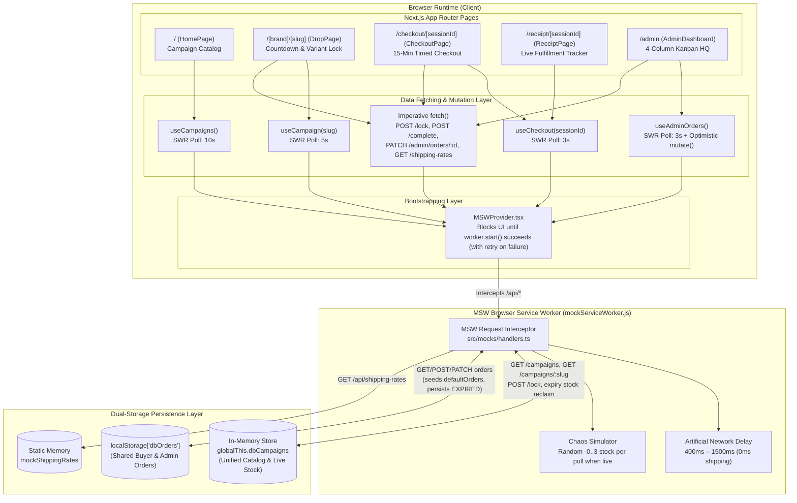
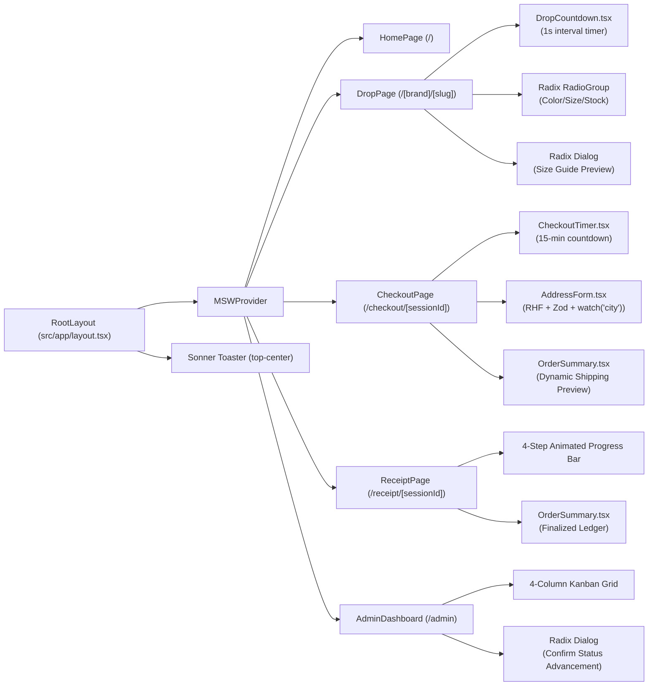
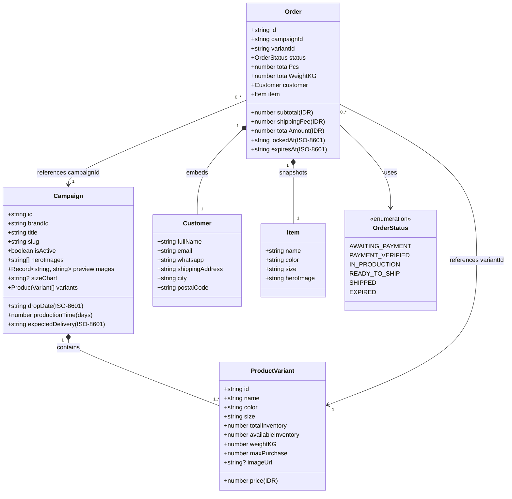
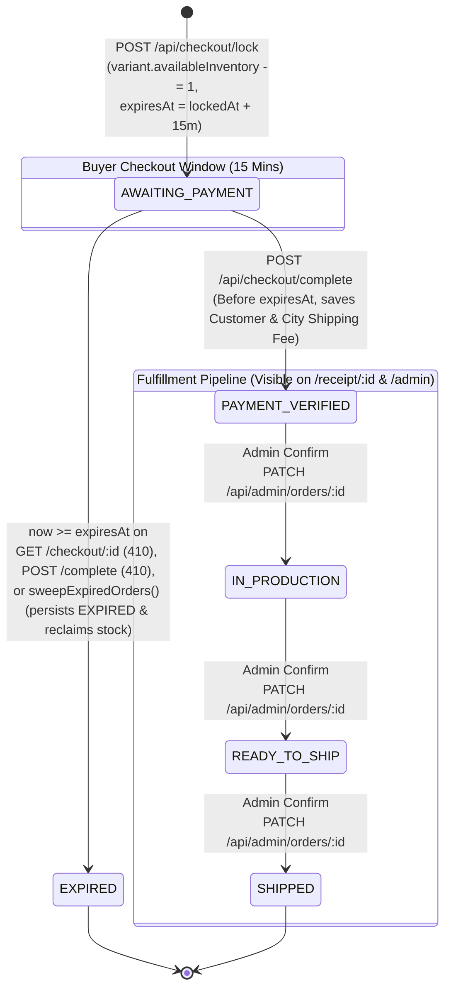
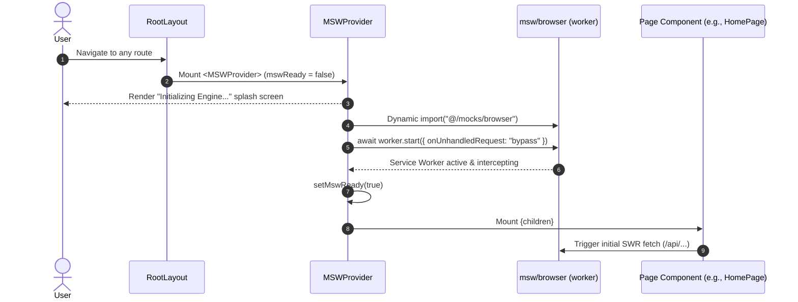
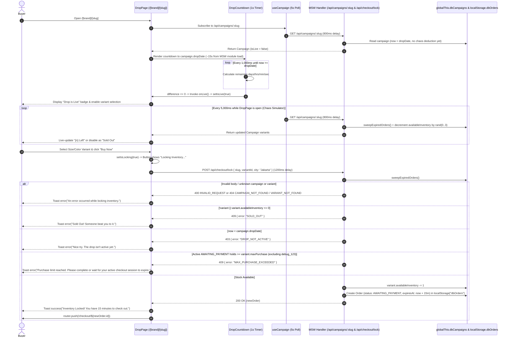
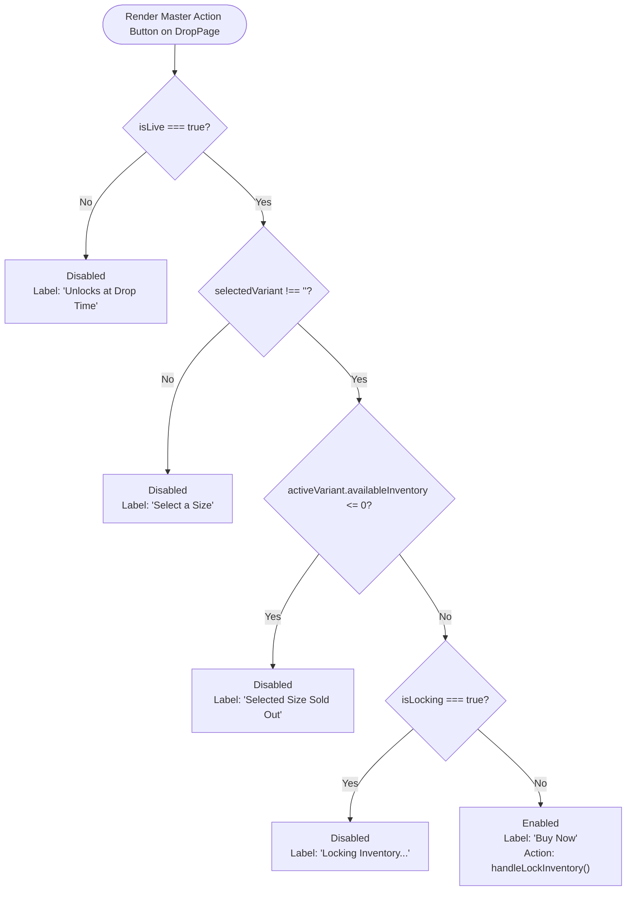
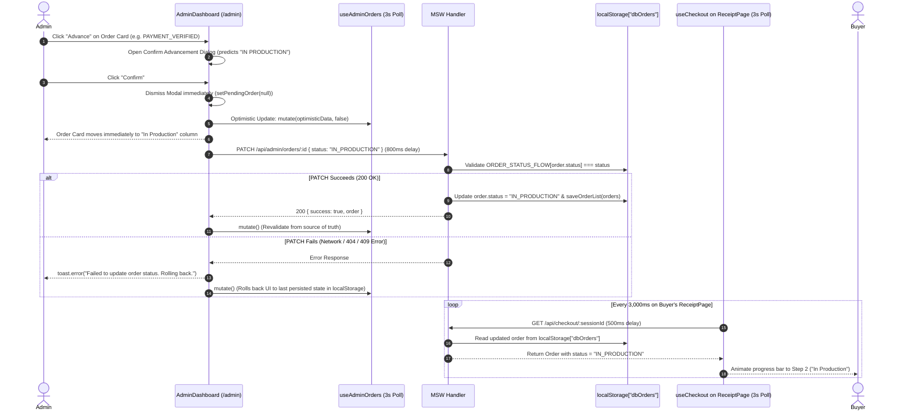
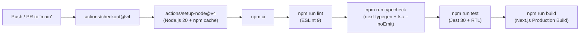

# LaunchQueue — System Design Document (`main` Branch)

> **Architecture Type:** Client-side Next.js 16 (App Router) high-concurrency product drop & pre-order simulation powered by **Mock Service Worker (MSW)**, **SWR polling**, **Optimistic UI mutations**, and a **Dual-Storage (`localStorage` + `globalThis`) persistence layer**.

---

## 1. Executive Summary & Tech Stack

**LaunchQueue** models the end-to-end lifecycle of a limited-edition streetwear flash drop—from launch countdown and high-concurrency inventory reservation ("The Bouncer") to a timed 15-minute checkout session, live order receipt tracking, and a seller fulfillment Kanban board.

### 1.1 Technology Stack Matrix

| Layer | Technology | Version | Responsibility in `main` |
| :--- | :--- | :--- | :--- |
| **Framework** | Next.js (App Router) | `16.2.4` | Client-rendered routes (`"use client"`), dynamic route segments, image optimization |
| **UI Runtime** | React / React DOM | `19.2.4` | Component state, countdown timers, modal/toast lifecycle |
| **Language** | TypeScript | `^5` | Strict domain typing (`Campaign`, `ProductVariant`, `Order`, `OrderStatus`) |
| **Styling** | Tailwind CSS + `tw-animate-css` | `^4` | Industrial minimal UI, animations, responsive split-screen & Kanban layouts |
| **UI Primitives** | shadcn/ui + Radix UI + Lucide + Sonner | `^4.4.0` / `^1.4.3` | Accessible `Dialog` (with `DialogDescription`), `RadioGroup`, `Label`, `Button`, and `toast` notifications |
| **Data Fetching & Sync** | SWR | `^2.4.1` | Polling-based state synchronization, focus revalidation, optimistic UI & rollback |
| **Forms & Validation** | React Hook Form + Zod | `^7.74.0` / `^4.4.1` | `onTouched` checkout form validation (trimmed inputs, phone/postal regex, dynamic city check) and reactive shipping calculation |
| **API Interception** | Mock Service Worker (MSW) | `^2.13.4` (worker `2.13.5`) | Browser Service Worker (`public/mockServiceWorker.js`) intercepting `/api/*` requests |
| **Persistence** | `window.localStorage` + `globalThis` | Browser Native | Persistent order ledger (`localStorage["dbOrders"]`) and unified in-memory catalog & stock (`globalThis.dbCampaigns`) |
| **Testing & CI** | Jest 30 + React Testing Library + GitHub Actions | `^30.4.2` | Automated lint, typecheck (`next typegen && tsc --noEmit`), unit/handler integration tests, and Next.js production build |

---

## 2. High-Level System Architecture

Because `main` runs as a self-contained browser prototype without an external backend server, **MSW acts as an in-browser API gateway and server simulator**, adding realistic network latency (`400ms–1500ms`), concurrency race conditions ("Chaos Simulator"), and HTTP status codes (`200`, `403`, `404`, `409`, `410`).



---

## 3. Route & Component Topology

### 3.1 Component Hierarchy Flowchart



### 3.2 Application Pages & Gatekeeper Matrix

| Route | File Path | Data Hook(s) | Polling / Refresh | Gatekeeper / Guard Conditions | Primary User Actions |
| :--- | :--- | :--- | :--- | :--- | :--- |
| `/` | `src/app/page.tsx` | `useCampaigns()` | Every `10,000ms` + `revalidateOnFocus: true` | Shows `"Initializing Engine..."` while loading; `"System Failure."` on error | Browse live drops, navigate to `/[brandSlug]/[slug]` (via `sanitizeBrandIdToSlug`) or `/admin` |
| `/[brand]/[slug]` | `src/app/(buyer)/[brand]/[slug]/page.tsx` | `useCampaign(slug)` | Every `5,000ms` + `revalidateOnFocus: true` | Shows `"Syncing with Engine..."` while loading; `"404 - Drop Not Found"` if missing, `!campaign.isActive`, or `sanitizeBrandIdToSlug(campaign.brandId) !== params.brand` | Watch countdown, view size chart modal, select variant, click **Buy Now** to lock stock |
| `/checkout/[sessionId]` | `src/app/checkout/[sessionId]/page.tsx` | `useCheckout(sessionId)` + `fetch('/api/shipping-rates')` | Every `3,000ms` (`revalidateOnFocus: false`) | Shows `"Securing Session..."` while loading; `"Session Expired or Invalid"` on `404`/`410`/`EXPIRED`/timer timeout; redirects paid orders (`status !== "AWAITING_PAYMENT"`) to `/receipt/[sessionId]` | Complete shipping form before 15-minute `CheckoutTimer` expires; dynamically preview shipping fee |
| `/receipt/[sessionId]` | `src/app/receipt/[sessionId]/page.tsx` | `useCheckout(sessionId)` | Every `3,000ms` (`revalidateOnFocus: false`) | Rejects `AWAITING_PAYMENT` and `EXPIRED` orders (`"Order Not Found or Payment Incomplete"` screen); allows `PAYMENT_VERIFIED`, `IN_PRODUCTION`, `READY_TO_SHIP`, `SHIPPED` indefinitely beyond 15 minutes | View live-updating 4-stage fulfillment progress bar, contact/address details, and itemized receipt |
| `/admin` | `src/app/admin/page.tsx` | `useAdminOrders()` | Every `3,000ms` (`revalidateOnFocus: false`) | Shows `"Failed to load fulfillment pipeline."` on error; filters out `AWAITING_PAYMENT` and `EXPIRED` orders from Kanban columns | Inspect paid orders, open confirmation modal, optimistically advance order status across 4 columns (`toast.error()` on rollback) |

---

## 4. Domain Data Model & Dual-Storage Design

### 4.1 Entity Relationship / Class Diagram (`src/types/index.ts`)



> **Note:** `src/types/index.ts` also exports `ShippingRates` (`Record<string, number>`), used by `GET /api/shipping-rates`, `mockShippingRates` (`src/mocks/data.ts`), and `CheckoutPage` to map destination cities to IDR shipping fees.

### 4.2 Dual-Storage Persistence Matrix (`src/mocks/handlers.ts` & `src/mocks/data.ts`)

| Storage Key / Container | Backing Store | Initial Seed Value | Read By Endpoints | Written By Endpoints | Cross-Tab Shared? | Survives Page Reload? |
| :--- | :--- | :--- | :--- | :--- | :--- | :--- |
| `globalThis.dbCampaigns` | Per-tab JS Heap Memory | Deep clone of `mockCampaign` (`dropDate = now + 15s`, `12` stock/variant, `expectedDelivery = soon + productionTime`) | `GET /api/campaigns`, `GET /api/campaigns/:slug`, `POST /api/checkout/lock`, expiry stock reclamation | `GET /api/campaigns/:slug` (Chaos Simulator), `POST /api/checkout/lock` (`-1` stock), `reclaimVariantStock` (`+totalPcs` on `EXPIRED`) | **No** (Isolated per tab) | **No** (Resets cleanly on reload; stale `localStorage["dbCampaigns"]` is cleared on init) |
| `localStorage["dbOrders"]` | Browser `localStorage` (SSR/test fallback: `globalThis.dbOrders`) | Deep clone of `defaultOrders` (`debug_123` in `IN_PRODUCTION`) | All order/campaign endpoints via `getOrders()` / `sweepExpiredOrders()` (re-seeds `defaultOrders` if empty or corrupted) | Any `getOrders()` endpoint on empty/corrupted read; `POST /api/checkout/lock`, `POST /api/checkout/complete`, `PATCH /api/admin/orders/:id`, and `expireOrderIfNeeded` / `sweepExpiredOrders` (persists `"EXPIRED"`) | **Yes** (Enables Buyer ↔ Admin live sync) | **Yes** |
| `mockShippingRates` | Static In-Memory Constant | 5 Indonesian cities (`Jakarta: 9000` … `Medan: 30000`) | `GET /api/shipping-rates`, `POST /api/checkout/lock`, `POST /api/checkout/complete` | None (Immutable) | Yes | Yes |

---

## 5. Order Lifecycle & State Machine

### 5.1 Order State Machine Diagram



### 5.2 State Transition & Visibility Matrix

| State (`OrderStatus`) | Entry Trigger | Next Allowed State | Visible on `/checkout/[id]`? | Visible on `/receipt/[id]`? | Visible on `/admin` Kanban? |
| :--- | :--- | :--- | :--- | :--- | :--- |
| `AWAITING_PAYMENT` | Buyer clicks **Buy Now** (`POST /api/checkout/lock`) | `PAYMENT_VERIFIED` or `EXPIRED` | **Yes** (while `now < expiresAt` and `!hasTimedOut`) | **No** (Blocked by `VALID_RECEIPT_STATUSES` guard) | **No** (Filtered out by `useAdminOrders`) |
| `EXPIRED` | `now >= expiresAt` on an `AWAITING_PAYMENT` order during `GET /api/checkout/:sessionId`, `POST /api/checkout/complete`, or `sweepExpiredOrders()` (persisted to `localStorage["dbOrders"]` and reclaims stock once) | Terminal State (`null`) | **No** (`410 SESSION_EXPIRED` error screen) | **No** (Blocked by guard) | **No** (Filtered out by `useAdminOrders`) |
| `PAYMENT_VERIFIED` | Buyer submits `AddressForm` (`POST /api/checkout/complete`) | `IN_PRODUCTION` | **No** (`CheckoutPage` redirects to `/receipt/[id]`; `POST /complete` returns `409 ORDER_ALREADY_COMPLETED`) | **Yes** (Timeline Step 1/4: *Paid*; accessible indefinitely beyond 15m) | **Yes** (Column 1: *New Orders*) |
| `IN_PRODUCTION` | Admin advances from *New Orders* (`PATCH /api/admin/orders/:id`) | `READY_TO_SHIP` | **No** (Redirects to `/receipt/[id]`; `POST /complete` returns `409`) | **Yes** (Timeline Step 2/4: *In Production*; accessible indefinitely beyond 15m) | **Yes** (Column 2: *In Production*) |
| `READY_TO_SHIP` | Admin advances from *In Production* (`PATCH /api/admin/orders/:id`) | `SHIPPED` | **No** (Redirects to `/receipt/[id]`; `POST /complete` returns `409`) | **Yes** (Timeline Step 3/4: *Ready to Ship*; accessible indefinitely beyond 15m) | **Yes** (Column 3: *Ready to Ship*) |
| `SHIPPED` | Admin advances from *Ready to Ship* (`PATCH /api/admin/orders/:id`) | Terminal State (`null`) | **No** (Redirects to `/receipt/[id]`; `POST /complete` returns `409`) | **Yes** (Timeline Step 4/4: *Shipped*; accessible indefinitely beyond 15m) | **Yes** (Column 4: *Fulfilled*, no Advance button) |

---

## 6. Core System Flows (Sequence Diagrams & Flowcharts)

### 6.1 Application Bootstrapping & MSW Gatekeeper

`MSWProvider` acts as a client-side gatekeeper in `src/app/layout.tsx`. No page component mounts or fires `useSWR` requests until the Service Worker is registered and ready.



### 6.2 Drop Countdown, Chaos Simulator & Inventory Lock Flow

When a drop goes live (`now >= dropDate`), every 5-second SWR poll to `GET /api/campaigns/:slug` invokes the **Chaos Simulator**, which deducts `0` to `3` units from each variant's `availableInventory` to simulate competing buyers.



### 6.3 Bouncer Button Decision Flowchart (`DropPage`)



### 6.4 Timed Checkout, Dynamic Shipping & Payment Finalization

```mermaid
sequenceDiagram
    autonumber
    actor Buyer
    participant Checkout as CheckoutPage (/checkout/[sessionId])
    participant Timer as CheckoutTimer (1s Interval)
    participant Form as AddressForm (RHF + Zod)
    participant Summary as OrderSummary
    participant MSW as MSW Handlers
    participant LS as localStorage["dbOrders"]

    Buyer->>Checkout: Arrive at /checkout/[sessionId]
    par Hydrate Session & Shipping Table
        Checkout->>MSW: GET /api/checkout/:sessionId (500ms delay, polled every 3s)
        MSW->>LS: Lookup order & run expireOrderIfNeeded (only if AWAITING_PAYMENT)
        alt Order missing (404) or EXPIRED (410)
            MSW-->>Checkout: 404 SESSION_NOT_FOUND or 410 SESSION_EXPIRED (persisted + stock reclaimed)
            Checkout-->>Buyer: Render "Session Expired or Invalid" + "Return to Lobby"
        else Already Paid / Fulfilled (status !== "AWAITING_PAYMENT")
            MSW-->>Checkout: 200 OK (Order)
            Checkout->>Buyer: router.replace("/receipt/:sessionId") ("Redirecting to Receipt...")
        else Active AWAITING_PAYMENT Session
            MSW-->>Checkout: 200 OK (Order)
        end
    and Fetch City Rates
        Checkout->>MSW: GET /api/shipping-rates
        MSW-->>Checkout: { Jakarta: 9000, Bandung: 11000, Surabaya: 19000, Bali: 25000, Medan: 30000 }
    end

    Checkout->>Timer: Mount with order.expiresAt (initial MM:SS computed immediately)
    loop Every 1,000ms
        Timer->>Timer: distance = expiresAt - now
        alt distance <= 0
            Timer->>Checkout: Invoke onExpire() once -> setHasTimedOut(true) + mutate()
        else distance > 0
            Timer-->>Buyer: Render MM:SS countdown
        end
    end

    Buyer->>Form: Fill Full Name, Email, WhatsApp, Address, City, Postal Code
    Form->>Checkout: watch("city") triggers onCityChange(selectedCity)
    Checkout->>Summary: Pass dynamicShippingFee = rates[dynamicCity] ?? order.shippingFee
    Summary-->>Buyer: Immediately recalculate & render activeTotal = subtotal + activeShippingFee

    Buyer->>Form: Click "Complete Purchase" (enabled only when Zod schema isValid; shows "Processing..." while submitting)
    Form->>MSW: POST /api/checkout/complete { sessionId, shippingDetails } (1500ms delay)
    MSW->>LS: Read orders, verify order exists & run expireOrderIfNeeded
    alt Order Expired (status === "EXPIRED")
        MSW-->>Form: 410 { error: "SESSION_EXPIRED" } (stock reclaimed)
        Form-->>Buyer: toast.error("SESSION_EXPIRED") & onExpire() / router.push("/")
    else Already Completed (status !== "AWAITING_PAYMENT")
        MSW-->>Form: 409 { error: "ORDER_ALREADY_COMPLETED", receiptUrl }
        Form->>Buyer: toast.error(...) & router.replace(receiptUrl)
    else Invalid City (not in mockShippingRates)
        MSW-->>Form: 400 { error: "INVALID_SHIPPING_DETAILS" }
        Form-->>Buyer: toast.error("INVALID_SHIPPING_DETAILS")
    else Within 15-Minute Window
        MSW->>LS: order.status = "PAYMENT_VERIFIED"<br/>order.customer = shippingDetails<br/>order.shippingFee = mockShippingRates[city]<br/>order.totalAmount = subtotal + shippingFee<br/>saveOrderList(orders)
        MSW-->>Form: 200 { success: true, receiptUrl: "/receipt/:sessionId" }
        Form->>Buyer: router.push("/receipt/:sessionId")
    end
```

### 6.5 Admin Kanban Optimistic Mutation & Cross-Tab Receipt Sync



---

## 7. Mock API Contract Specification (`src/mocks/handlers.ts`)

### 7.1 Endpoint Reference Table

| # | Method & Path | Simulated Latency | Request Body / Params | Success Response (`200`) | Error Responses | Side Effects & Storage Mutations |
| :-: | :--- | :--- | :--- | :--- | :--- | :--- |
| **1** | `GET /api/campaigns` | `500ms` | None | `Campaign[]` | — | Runs `sweepExpiredOrders()`; returns unified `globalThis.dbCampaigns` (removes stale `localStorage["dbCampaigns"]`) |
| **2** | `GET /api/campaigns/:slug` | `800ms` | `params.slug` | `Campaign` | `404 { message: "Not Found" }` | Runs `sweepExpiredOrders()`; if `now >= dropDate`, runs **Chaos Simulator**: decrements each variant's `availableInventory` by `0..3` in `globalThis.dbCampaigns` |
| **3** | `GET /api/shipping-rates` | `0ms` | None | `ShippingRates` (`Record<string, number>`) | — | Read-only from `mockShippingRates` |
| **4** | `POST /api/checkout/lock` | `1200ms` | `{ slug: string, variantId: string, city: string }` | `Order` (`status: "AWAITING_PAYMENT"`, `expiresAt: +15m`) | `400 { error: "INVALID_REQUEST" }`<br/>`404 { error: "CAMPAIGN_NOT_FOUND" \| "VARIANT_NOT_FOUND" }`<br/>`409 { error: "SOLD_OUT" \| "MAX_PURCHASE_EXCEEDED" }`<br/>`403 { error: "DROP_NOT_ACTIVE" }` | Sweeps expired orders; enforces active `AWAITING_PAYMENT` hold count `< variant.maxPurchase` (excluding `debug_123`); decrements `variant.availableInventory -= 1` in `globalThis.dbCampaigns`; appends new `Order` to `localStorage["dbOrders"]` |
| **5** | `GET /api/checkout/:sessionId` | `500ms` | `params.sessionId` | `Order` | `404 { error: "SESSION_NOT_FOUND" }`<br/>`410 { error: "SESSION_EXPIRED" }` | Expires only `AWAITING_PAYMENT` orders where `now >= expiresAt` (persists `"EXPIRED"` to `localStorage["dbOrders"]` and reclaims stock once); paid/fulfilled orders remain accessible (`200`) indefinitely |
| **6** | `POST /api/checkout/complete` | `1500ms` | `{ sessionId: string, shippingDetails: CheckoutFormData }` | `{ success: true, receiptUrl: "/receipt/:sessionId" }` | `400 { error: "INVALID_REQUEST" \| "INVALID_SHIPPING_DETAILS" }`<br/>`404 { error: "ORDER_NOT_FOUND" }`<br/>`410 { error: "SESSION_EXPIRED" }`<br/>`409 { error: "ORDER_ALREADY_COMPLETED", receiptUrl }` | Expires overdue `AWAITING_PAYMENT` orders (`410` + stock reclaim); rejects non-`AWAITING_PAYMENT` orders (`409`) and unsupported cities (`400`); otherwise sets `status = "PAYMENT_VERIFIED"`, saves `customer`, recalculates `shippingFee` & `totalAmount`, persists to `localStorage["dbOrders"]` |
| **7** | `GET /api/admin/orders` | `400ms` | None | `Order[]` | — | Runs `sweepExpiredOrders()` and returns all orders from `localStorage["dbOrders"]` (seeding `defaultOrders` if empty or corrupted) |
| **8** | `PATCH /api/admin/orders/:id` | `800ms` | `{ status: OrderStatus }` | `{ success: true, order: Order }` | `400 { error: "INVALID_REQUEST" }`<br/>`404 { error: "ORDER_NOT_FOUND" }`<br/>`409 { error: "INVALID_STATUS_TRANSITION" }` | Validates sequential `ORDER_STATUS_FLOW[order.status] === status`; updates `order.status` and persists to `localStorage["dbOrders"]` |

### 7.2 Shipping Rate & Catalog Reference Tables

#### Simulated Domestic Shipping Rates (`mockShippingRates`)

| Destination City | Shipping Fee (IDR) | Notes |
| :--- | ---: | :--- |
| **Jakarta** | `Rp 9.000` | Default city passed during `POST /api/checkout/lock` |
| **Bandung** | `Rp 11.000` | Selectable in `AddressForm` |
| **Surabaya** | `Rp 19.000` | Selectable in `AddressForm` |
| **Bali** | `Rp 25.000` | Selectable in `AddressForm` |
| **Medan** | `Rp 30.000` | Selectable in `AddressForm` |
| *(Fallback)* | `Rp 25.000` | Used by handlers if city is not found in `mockShippingRates` |

#### Bundled Sample Campaigns (`mockCampaign`)

| Campaign ID | Brand ID | Slug | Title | Price (IDR) | Variants | Initial Stock / Variant | Max Purchase | Production Lead Time |
| :--- | :--- | :--- | :--- | ---: | :--- | :---: | :---: | :---: |
| `camp_kith_jkt_001` | `kith` | `knicks-hoodie` | Kith for the New York Knicks | `Rp 2.500.000` | 6 (`Black` S/M/L, `Blue` S/M/L) | `12` (`72` total) | `1` | `21 days` |
| `camp_fear_of_god_jkt_002` | `fear_of_god` | `relaxed-fear-of-good-tee` | Relaxed Fear Of God Long Sleeve Tee | `Rp 2.622.000` | 3 (`Black` S/M/L) | `12` (`36` total) | `1` | `14 days` |

---

## 8. Timers, Polling & Concurrency Matrix

| Mechanism | Location | Interval / Duration | Purpose |
| :--- | :--- | :--- | :--- |
| **Initial Drop Launch Offset** | `src/mocks/data.ts` | `+15,000ms` from module load | Gives the user a 15-second countdown experience upon loading a drop |
| **Drop Countdown Tick** | `src/components/drop/DropCountdown.tsx` | `1,000ms` (`setInterval`) | Updates `Days : Hrs : Min : Sec` and fires `onLive()` at `<= 0` |
| **Reservation Lock Window** | `src/mocks/handlers.ts` (`/api/checkout/lock`) | `15 minutes` (`15 * 60,000ms`) | Sets `order.expiresAt`; enforced by both UI timer and MSW endpoints |
| **Checkout Countdown Tick** | `src/components/checkout/CheckoutTimer.tsx` | `1,000ms` (`setInterval`) | Renders `MM:SS` badge immediately on mount without `"15:00"` flash; invokes `onExpire()` once when `distance <= 0` (`CheckoutPage` sets immediate expired UI + `mutate()`) and clears interval on unmount |
| **Homepage Catalog Poll** | `src/lib/hooks/useCampaigns.ts` | `10,000ms` + `revalidateOnFocus: true` | Keeps campaign cards synced |
| **Drop Page Stock Poll** | `src/lib/hooks/useCampaign.ts` | `5,000ms` + `revalidateOnFocus: true` | Refreshes variant stock counts and triggers MSW Chaos Simulator |
| **Checkout & Receipt Poll** | `src/lib/hooks/useCheckout.ts` | `3,000ms` (`revalidateOnFocus: false`) | Detects session expiry on Checkout and Admin status updates on Receipt |
| **Admin Kanban Poll** | `src/lib/hooks/useAdminOrders.ts` | `3,000ms` (`revalidateOnFocus: false`) | Syncs newly completed buyer orders into the Kanban pipeline |
| **Receipt Progress Animation** | `src/app/receipt/[sessionId]/page.tsx` | `800ms` mount delay; bar `transitionDuration: currentStepIndex * 1000ms`; step badge `transitionDelay: max(0, index * 1000 - 150)ms` (`duration-500`) | Smoothly animates the 4-stage fulfillment progress bar |

---

## 9. Testing & CI/CD Pipeline Architecture

### 9.1 GitHub Actions Workflow (`.github/workflows/ci.yml`)



### 9.2 Automated Test Suite Coverage (`__tests__/`)

| Test Suite | Target Component / Module | Verified Behaviors |
| :--- | :--- | :--- |
| `__tests__/HomePage.test.tsx` | `src/app/page.tsx` | 1. Gatekeeper renders `"Initializing Engine..."` when `isLoading: true`<br/>2. Renders campaign cards, titles, and `"Live"` indicator when loaded |
| `__tests__/DropPage.test.tsx` | `src/app/(buyer)/[brand]/[slug]/page.tsx` | 1. Unlocks UI when `DropCountdown` triggers `onLive()`<br/>2. Enables `"Buy Now"` after selecting a variant, switches to `"Locking Inventory..."` during in-flight `POST /api/checkout/lock`, and verifies request payload<br/>3. Disables sold-out variants (`availableInventory: 0`) and keeps master button disabled<br/>4. Renders `"404 - Drop Not Found"` on `[brand]` mismatch, surfaces `MAX_PURCHASE_EXCEEDED` toast, and opens Size Guide modal with zero Radix warnings |
| `__tests__/DropCountdown.test.tsx` | `src/components/drop/DropCountdown.tsx` | 1. Ticks down every second, fires `onLive()` once at zero, and cleans up interval on unmount<br/>2. Fires `onLive()` immediately when `dropDate` is already in the past |
| `__tests__/CheckoutPage.test.tsx` | `src/app/checkout/[sessionId]/page.tsx`, `AddressForm.tsx`, `OrderSummary.tsx`, `CheckoutTimer.tsx` | 1. Renders `"Securing Session..."` while loading and `"Session Expired or Invalid"` on `EXPIRED` / error<br/>2. Redirects paid orders to `/receipt/[id]` instead of rendering checkout form<br/>3. Validates `AddressForm` Zod rules (WhatsApp, 5-digit postal code, synced cities), updates `OrderSummary` dynamically, and submits `POST /api/checkout/complete`<br/>4. Handles `409` receipt redirect and `410` expiry via `toast.error()` + `mutate()`<br/>5. Verifies `CheckoutTimer` initial render without `"15:00"` flash, unmount cleanup, and `00:00` expiry callback |
| `__tests__/ReceiptPage.test.tsx` | `src/app/receipt/[sessionId]/page.tsx` | 1. Gatekeeper renders `"Retrieving Order..."` and blocks `AWAITING_PAYMENT`, `EXPIRED`, and error states<br/>2. Renders customer contact/shipping details and persisted `OrderSummary` totals<br/>3. Animates the 4-stage timeline bar and step badges across `PAYMENT_VERIFIED`, `IN_PRODUCTION`, `READY_TO_SHIP`, and `SHIPPED` |
| `__tests__/AdminDashboard.test.tsx` | `src/app/admin/page.tsx` | 1. Maps active orders into the 4 Kanban columns and renders error screen when `isError` is true<br/>2. Opens `"Confirm Advancement"` modal predicting `IN PRODUCTION` with zero Radix warnings and supports cancellation<br/>3. Fires optimistic `mutate(updatedOrders, false)` immediately on confirm, sends `PATCH /api/admin/orders/:id`, and rolls back via `toast.error()` + `mutate()` on failure<br/>4. Formats single and multi-underscore order display codes safely |
| `__tests__/handlers.test.ts` | `src/mocks/handlers.ts` | 1. Unifies catalog on `globalThis.dbCampaigns`, removes stale `localStorage["dbCampaigns"]`, and verifies `G15` seed alignment<br/>2. Reclaims stock once and persists `"EXPIRED"` to `localStorage["dbOrders"]` on timeout (`G2`, `G3`)<br/>3. Keeps paid orders accessible past 15m (`G8`), returns `409` on duplicate complete (`G10`), and rejects unsupported shipping cities (`G14`)<br/>4. Enforces lock guards, `maxPurchase` excluding `debug_123`, `ORDER_STATUS_FLOW` transitions (`G12`), and corrupted storage recovery (`G13`) |
